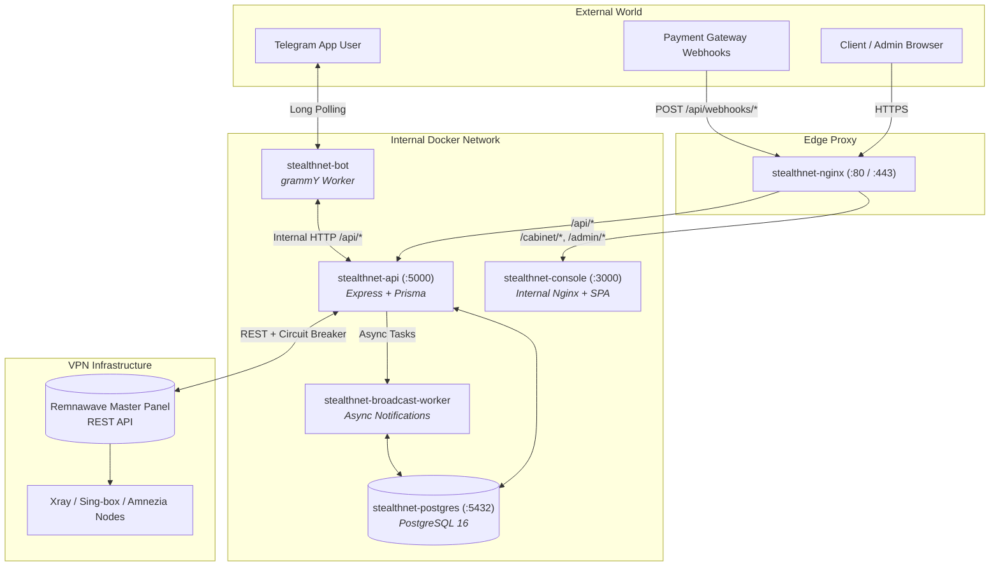
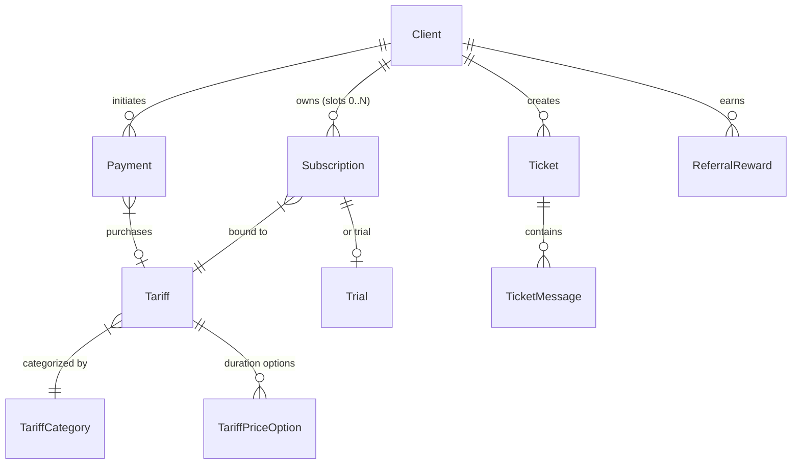

# AGENTS.md — Master Architecture Guide & Codebase Map

> **Target Audience:** Autonomous AI Coding Agents (Cursor, Claude Code, Codex, Antigravity, Aider, Windsurf, Copilot) & Human Core Contributors.  
> **Purpose:** Authoritative single source of truth for the `STEALTHNET` repository. Eliminates redundant codebase scanning, establishes strict architectural invariants, and provides exact file navigation maps.

---

## 1. High-Level Architecture & Tech Stack

**STEALTHNET** is an enterprise-grade automated billing, user management, and key distribution platform for VPN services powered by **Remnawave**. It connects Telegram users, Web App clients, payment gateways, and VPN nodes into a unified reactive ecosystem.

### System Stack

| Layer | Technologies & Runtime | Core Packages & Frameworks |
| :--- | :--- | :--- |
| **Backend API** | Node.js `>=22`, TypeScript `5.6`, Express `4.21` | `@prisma/client` (6.0), `undici`, `node-cron`, `jose`, `zod`, `otplib`, `socks-proxy-agent` |
| **Telegram Bot** | Node.js `>=22`, TypeScript `5.6`, grammY `1.21` | `grammy`, `undici`, `socks-proxy-agent` |
| **Frontend UI** | React `18`, TypeScript `5.6`, Vite | Tailwind CSS, Radix UI, TanStack Query 5, `lucide-react`, `react-i18next`, `@dnd-kit` |
| **Database** | PostgreSQL `16` | Prisma ORM 6.0 (`backend/prisma/schema.prisma`) |
| **Workers** | Node.js isolated background processes | `stealthnet-broadcast-worker` (mass queues, asynchronous notifications) |
| **VPN Nodes** | Sing-box, Xray, AmneziaWG | `singbox-node/`, `proxy-node/`, `amneziawg-node/` |
| **Infrastructure** | Docker Compose, Nginx, Certbot | `docker-compose.yml`, `nginx/nginx.conf` |

---

## 2. Docker Architecture & Container Topology

The application runs as 6 orchestrated containers on an internal bridge network (`stealthnet_network`):



### Container Responsibilities & Port Bindings:
* **`stealthnet-api`**: Core business API (port `127.0.0.1:5000`). Handles Auth, Subscriptions, Payments, Fiscalization, Sync, and Remnawave REST calls.
* **`stealthnet-bot`**: Autonomous Telegram bot. Polls Telegram Bot API, renders inline menus, handles WebApp launches, notifies users.
* **`stealthnet-console`**: Serves React SPA (Admin panel & Client cabinet) via internal lightweight server on port `3000`.
* **`stealthnet-broadcast-worker`**: Consumes broadcast queue from PostgreSQL, sending throttled messages to Telegram users without blocking API threads.
* **`stealthnet-postgres`**: Relational data store on `127.0.0.1:5432`.
* **`stealthnet-nginx`**: Edge gateway handling SSL termination, static file caching, and routing.

---

## 3. Core Database Entities & Data Relationships (Prisma)

The schema in `backend/prisma/schema.prisma` contains 68 models. The core domain revolves around:



### Key Models & Their Invariants:
1. **`Client`**: Represents a registered user.
   - `id`: Internal UUID.
   - `telegramId`: BigInt/string Telegram User ID (used for bot auth and Remnawave mapping).
   - `remnawaveUuid`: Mirrors the UUID of the primary subscription (`subscriptionIndex = 0`) in Remnawave.
   - `balance`: Virtual credit balance.
   - `trialUsed`: Boolean flag preventing trial abuse.
2. **`Subscription`**: The core VPN access entity.
   - `ownerId`: Foreign key to `Client`.
   - `subscriptionIndex`: Integer index (`0` = primary subscription, `1+` = secondary / gift).
   - `remnawaveUuid`: Unique identifier of user profile in Remnawave.
   - `tariffId`: Foreign key to `Tariff` (can be `null` if imported from Remnawave or expired).
   - `autoRenewEnabled`: Boolean toggle for automatic card/balance recurring renewal.
   - `expireAt`: Cached expiration timestamp used for offline fallbacks and quick filters.
3. **`Payment`**: Financial transaction record.
   - `provider`: Gateway identifier (`yookassa`, `yoomoney`, `platega`, `stars`, `heleket`, `crypto`, etc.).
   - `status`: `PENDING` -> `PAID` / `FAILED` / `CANCELLED`.
   - `metadata`: JSON payload holding purchase parameters, including `pendingRemnaActivation` flag during Remnawave downtime.
4. **`SystemSetting`**: Key-value table storing dynamic runtime settings loaded via `getSystemConfig()`.

---

## 4. Backend Modules Directory Map (69 Modules Categorized)

All backend domain modules reside in `backend/src/modules/`:

### A. Core VPN & Remnawave Integration
* **`remna/`**: Remnawave REST API client (`remna.client.ts`), Circuit Breaker pattern, connection state probe, squad/host/node management.
* **`sync/`**: Two-way synchronization engine (`sync.service.ts`, `sync.scheduler.ts`) syncing users and traffic counters between Remnawave and PostgreSQL.
* **`server/`**: Server nodes and backend infrastructure management.
* **`proxy/` & `proxy-util/`**: HTTP/SOCKS5 proxy management and nodes.
* **`singbox/`**: Sing-box node subscription and protocol generation.
* **`amnezia-web/`**: Integration with Amnezia Web / AmneziaWG protocols.

### B. Billing, Tariffs & Subscriptions
* **`subscription/`**: Slot management helpers (`subscription.helpers.ts`), extra devices pricing (`extras.helper.ts`), traffic calculations.
* **`tariff/`**: Tariff definitions, categories, duration pricing, and payment fulfillment (`tariff-activation.service.ts`).
* **`trial/`**: Trial activation, eligibility checks, and conversion rules.
* **`gift/`**: Gift purchase, gift codes generation, and multi-subscription creation (`createAdditionalSubscription`).
* **`extra-options/`**: Upselling additional device slots and speed boosts.
* **`tariff-csv/`**: Bulk export/import of tariff configurations.

### C. Payment Gateways (The 11 Providers)
* **`payment/`**: Unified payment router, invoice creation, balance deductions, and `auto-renew.cron.ts`.
* **`platega/`**: Platega card processing and webhooks.
* **`yookassa/`**: YooKassa API, webhooks, and 54-FZ receipt fiscalization.
* **`yoomoney/`**: YooMoney P2P notifications with HMAC SHA1 verification.
* **`cryptopay/`**: Telegram @CryptoBot integration.
* **`telegram-stars/`**: Native Telegram Stars digital payment processing.
* **`heleket/`**: Heleket gateway integration.
* **`rollypay/`**: RollyPay card acquisition.
* **`paritypay/`**: ParityPay gateway integration.
* **`lava/` & `lavatop/`**: Lava.ru and Lavatop digital payment processing.
* **`overpay/`**: Overpay gateway integration.
* **`nalog/`**: Integration with official Russian self-employed tax service (Мой налог).

### D. Identity, Client & Admin Auth
* **`client/`**: Client registration (`/register`), Telegram login check, client routes (`client.routes.ts`), system config cache.
* **`auth/`**: Admin JWT authentication, password reset, 2FA OTP verification.
* **`admin/`**: Admin dashboard CRUD APIs for clients, tariffs, and servers.
* **`admin-permissions/`**: Role-based access control (RBAC) for sub-admins.
* **`clients-bulk/`**: Bulk client management (ban, unban, migration).

### E. Marketing, Referrals & Community
* **`referral/`**: 3-level referral network tracking, reward calculations, and withdrawal processing.
* **`promo-code/` & `promo-bulk/`**: Promo code generation, redemption limits, and bulk issuing.
* **`contest/`**: Referral and engagement contests with automated winner selection and daily reminders.
* **`roulette/`**: Gamified "Lucky Wheel" spins granting balance or extra VPN days.
* **`landing/`**: Built-in landing page CMS and blocks API.
* **`marketplace/`**: Plugin and theme marketplace.

### F. Support & Notifications
* **`ticket/`**: Support ticketing system between users and staff.
* **`broadcast/`**: Targeted mass notifications to bot users with filtering.
* **`auto-broadcast/`**: Automated trigger-based mailings (e.g. 3 days before expiry, inactive user).
* **`notification/` & `notifications-counters/`**: In-app notifications and badge counters.
* **`bot-messages/` & `bot-conversations/`**: Live chat mirroring between bot and admin.

### G. Security, Anti-Abuse & System
* **`anti-abuse/`**: Automated detection of traffic and device sharing abuse with auto-ban/unban schedulers.
* **`anti-fraud/`**: Suspicious payment and referral cycle detection.
* **`blacklist/`**: IP and Telegram ID blacklisting.
* **`signup-protection`**: Rate limiting and anti-bot verification on register.
* **`backup/`**: Automated PostgreSQL database dumps and Telegram delivery.
* **`diagnostics/`**: System health check, Remnawave latency probes, cron registry.
* **`audit/`**: Audit log of administrative actions.

---

## 5. Telegram Bot Architecture (`bot/src/`)

The bot is built on the **grammY** framework. Entry point: `bot/src/index.ts`.

### Callback Query Routing & Namespaces:
All inline buttons follow a structured namespace protocol:
* `menu:main` — Return to root keyboard.
* `menu:tariffs` — Open tariff selection (or maintenance screen if Remna is down).
* `menu:my_subs` — Display active and offline subscriptions with connect URLs.
* `menu:devices` — Device management flow (`device-flow.ts`).
* `menu:topup` — Balance recharge menu.
* `menu:trial` — Trial activation screen.
* `menu:gifts` — Gift subscription issuance.
* `menu:support` — Ticket creation and support dialogue.
* `menu:proxy` & `menu:singbox` — Dedicated protocol slots.
* `pay:<provider>:<tariffId>:<optionId>` — Payment invoice generation.
* `yk_recpt:<no|saved|ask>:<token>` — 54-FZ tax receipt prompt for YooKassa.
* `sub:<index>` — Select subscription slot.

### Dual Interface Mode:
The bot dynamically adapts to two interface modes configured by the administrator:
1. **Classic Mode**: Navigates entirely through Telegram inline messages and keyboards (`keyboard.ts`).
2. **Web Mode (Mini App)**: Telegram buttons open the WebApp at `https://<domain>/cabinet/<route>`.

---

## 6. Frontend Architecture (`frontend/src/`)

A Vite-powered React 18 SPA serving two distinct layouts:

1. **Admin Console (`frontend/src/pages/`)**:
   - `dashboard.tsx`: Business KPIs, sales charts, and active nodes.
   - `tariffs.tsx`: Tariff constructor (squads, duration tiers, price per day, device options).
   - `clients.tsx`: Client database with filtering, subscription inspection, and manual balance adjustment.
   - `settings.tsx`: Master configuration center (remna, branding, payments, bot buttons, backups).
   - `broadcast.tsx` & `auto-broadcast.tsx`: Notification campaigns and trigger automations.
2. **Client Cabinet PWA (`frontend/src/pages/cabinet/`)**:
   - Designed for mobile screens and Telegram WebApp integration.
   - Subscriptions list, QR-code display, connection key copy, speed test guides, and balance top-up.
   - Protected with PWA Service Worker caching (`vite-plugin-pwa`) and automatic update detection.

---

## 7. Critical Domain Invariants & Rules (The "Gotchas" Index)

> [!CAUTION]
> Breaking these invariants will corrupt user subscriptions, duplicate profiles, or drop paid transactions!

### Invariant 1: The Subscription Slot 0 Model
* Every client has a primary subscription slot: `subscriptionIndex = 0`.
* `Client.remnawaveUuid` **always** mirrors the primary slot's `Subscription.remnawaveUuid`.
* Slots with `subscriptionIndex >= 1` are secondary subscriptions or gifts.
* If slot `#0` expires or is revoked, its database record **is never deleted**; it retains `tariffId = null`. The client's subsequent purchase must update slot `#0`, restoring primary status.

### Invariant 2: Remnawave Profile Deduplication (Issue #233)
* Remnawave maps users by `uuid` and `telegramId`.
* **Never** call `remnaCreateUser` blindly upon user registration or first purchase.
* Always query `remnaGetUserByTelegramId(telegramId)`:
  - If a profile exists in Remnawave: link its `uuid` to `client.remnawaveUuid` and slot `#0`.
  - On tariff purchase: call `remnaUpdateUser` (extending `expireAt` and syncing squads), **do not** call `remnaCreateUser`.

### Invariant 3: Remnawave Fault-Tolerance & Circuit Breaker (PR #235)
* All calls to Remnawave are wrapped by the Circuit Breaker (`backend/src/modules/remna/remna.client.ts`).
* When Remnawave fails 3 times consecutively, the circuit opens (`OPEN`), failing instantly in 0ms.
* **In-Flight Bank Webhooks**: If a bank webhook confirms payment while Remnawave is offline:
  - Mark payment as `PAID`.
  - Set `payment.metadata.pendingRemnaActivation = true`.
  - **Do not drop or fail the transaction!** The background cron `processPendingRemnaActivations` retries activation automatically as soon as Remnawave recovers.

### Invariant 4: Dual Verification for YooMoney & YooKassa
* YooMoney webhook verification must use HMAC SHA1 against `YOOMONEY_NOTIFICATION_SECRET`.
* YooKassa uses basic HTTP authentication and IP range validation.

### Invariant 5: Safe Production Server Configurations
* Never commit or overwrite local runtime port bindings in `docker-compose.yml` (`127.0.0.1:5000` for API, `127.0.0.1:3001` for Uptime Kuma).
* Keep PR branches clean and derived strictly from `origin/main`.

---

## 8. Background Crons & Workers Inventory

| Schedule | Frequency | File | Function / Purpose |
| :--- | :--- | :--- | :--- |
| `* * * * *` | Every 1 min | `payment/auto-renew.cron.ts` | Auto-renewal charges & pending Remna retries |
| `* * * * *` | Every 1 min | `sync/sync.scheduler.ts` | Remnawave 2-way sync (`runScheduledRemnaSync`) |
| `* * * * *` | Every 1 min | `referral/referral-rewards.scheduler.ts` | Accrue pending referral rewards |
| `15,45 * * * *` | Every 30 min | `gift/gift-expiry.cron.ts` | Expire unredeemed gift codes |
| Configurable (`0 9 * * *`) | Daily | `auto-broadcast/auto-broadcast-scheduler.ts` | Trigger auto-mailings (ending soon, inactivity) |
| Configurable (`0 10 * * *`) | Daily | `contest/contest-daily-reminder-scheduler.ts` | Send contest ranking updates |
| Configurable (`0 1 * * *`) | Daily | `backup/auto-backup.scheduler.ts` | Execute pg_dump & send Telegram backup |
| Dynamic | By rule | `anti-abuse/anti-abuse.scheduler.ts` | Traffic surge detection & auto-unban |

---

## 9. Developer & AI Agent "How-To" Playbooks

### Playbook 1: Adding a New Payment Gateway
1. Create driver module: `backend/src/modules/<gateway>/`.
2. Implement invoice creator returning payment URL.
3. Add webhook route in `backend/src/modules/<gateway>/<gateway>.routes.ts` with signature verification.
4. On verified payment, call `activateTariffByPaymentId(paymentId)` from `tariff-activation.service.ts`.
5. Guard webhook with `requireRemnaOnline` or handle `pendingRemnaActivation`.
6. Add gateway keys to `SystemSetting` and expose in Admin Console (`frontend/src/pages/settings.tsx`).

### Playbook 2: Adding a New System Setting Toggle
1. Add setting key to `SYSTEM_CONFIG_KEYS` in `backend/src/modules/client/client.service.ts`.
2. Expose typed field in `loadSystemConfigFromDb()`.
3. Add UI controller in `frontend/src/pages/settings.tsx`.
4. Consume via `await getSystemConfig()` anywhere in backend or bot.

### Playbook 3: Adding a Telegram Bot Menu Button
1. Add button descriptor to `bot/src/keyboard.ts`.
2. Register callback query handler in `bot/src/index.ts` (handle both classic message edit and WebApp URL).
3. If new API data is required, define type-safe method in `bot/src/api.ts`.

---

## 10. Build, Test & Verification Commands

```bash
# === Backend Verification ===
cd backend && npx prisma generate
cd backend && npm run build
node --test backend/tests/*.test.mjs

# === Telegram Bot Verification ===
cd bot && npm run build
node --test bot/src/*.test.ts

# === Frontend Verification ===
cd frontend && npm run build

# === Docker Compose Full Staging Build ===
docker compose build --no-cache api bot console broadcast-worker frontend
docker compose up -d --force-recreate
```
