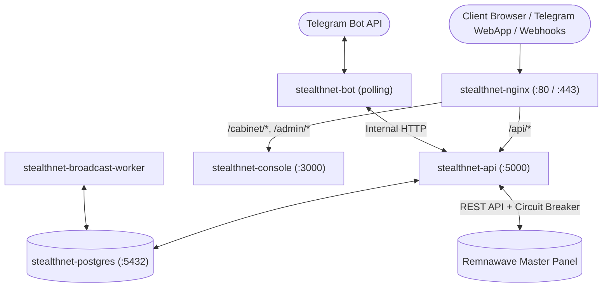
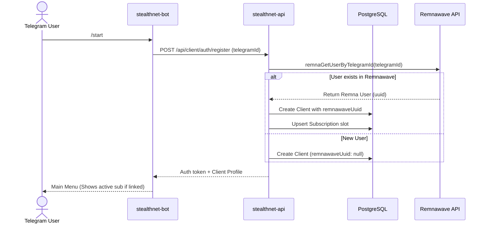
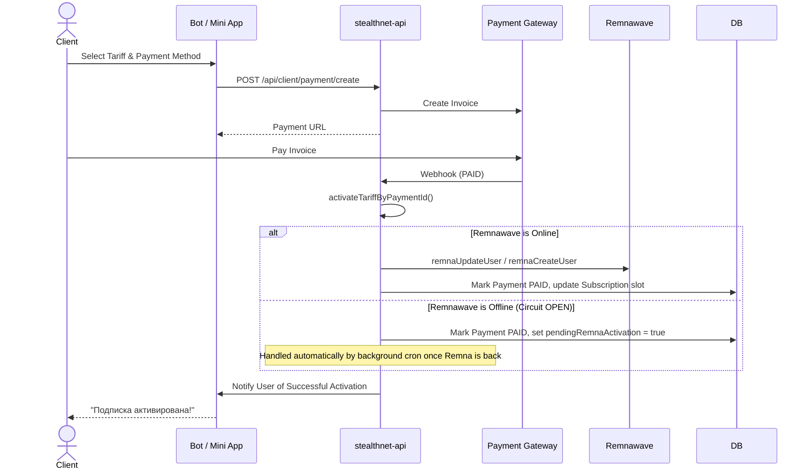

# AGENTS.md — AI Agent Architecture Guide & Codebase Map

> **For AI Coding Assistants (Cursor, Claude Code, Codex, Antigravity, Aider, Windsurf, Copilot)**
> This file is the primary context and source of truth for the `STEALTHNET` codebase.
> Read this file first before making changes, exploring files, or formulating execution plans.

---

## 1. Project Overview & Tech Stack

**STEALTHNET** is an all-in-one platform for selling and distributing VPN subscriptions built on top of **Remnawave**. It provides a Telegram bot (with Telegram Mini App support), a web client cabinet (PWA), and a full-featured admin console.

### Technology Stack

| Layer | Technologies & Versions | Key Libraries |
| :--- | :--- | :--- |
| **Backend API** | Node.js `>=22`, TypeScript `5.6`, Express `4.21` | `@prisma/client` (6.0), `undici`, `node-cron`, `jose`, `zod`, `otplib` |
| **Telegram Bot** | Node.js `>=22`, TypeScript `5.6`, grammY `1.21` | `grammy`, `undici`, `socks-proxy-agent` |
| **Frontend UI** | React `18`, TypeScript `5.6`, Vite | Tailwind CSS, Radix UI, TanStack Query 5, `lucide-react`, `react-i18next` |
| **Database** | PostgreSQL `16` | Prisma ORM 6.0 (`backend/prisma/schema.prisma`) |
| **Workers** | Node.js background process | `stealthnet-broadcast-worker` (mass notifications) |
| **Proxy / Nodes** | Sing-box, Xray, AmneziaWG | `singbox-node/`, `proxy-node/`, `amneziawg-node/` |
| **Infrastructure** | Docker Compose, Nginx, Certbot | `docker-compose.yml`, `nginx/nginx.conf` |

---

## 2. Docker Architecture & Container Topology

The application runs as 6 main containers configured via `docker-compose.yml`:



* **`stealthnet-api`**: Express backend on port `5000` (internal). Handles authentication, business logic, payments, and communicates with Remnawave.
* **`stealthnet-bot`**: grammY Telegram bot. Polls Telegram API and calls `stealthnet-api` via internal HTTP.
* **`stealthnet-console`**: Static SPA (Admin panel + Client cabinet) served by internal Nginx on port `3000`.
* **`stealthnet-broadcast-worker`**: Runs background mailings and heavy notification queues without blocking the API.
* **`stealthnet-postgres`**: PostgreSQL 16 database.
* **`stealthnet-nginx`**: Public reverse proxy terminating SSL and routing incoming traffic.

---

## 3. Critical Domain Invariants & Rules (MUST READ)

> [!IMPORTANT]
> Violating these rules will cause production outages, payment loss, or profile duplications!

### 1. Subscription Slot 0 Model
* Every client has a primary subscription slot: `subscriptionIndex = 0`.
* `Client.remnawaveUuid` mirrors the `Subscription` with `subscriptionIndex = 0`.
* Slots with `subscriptionIndex >= 1` are **secondary subscriptions** or **gift purchases**.
* When a primary subscription expires or is revoked, its record remains in the database with `tariffId = null`. The client's next purchase **updates/renews** this slot `#0` rather than creating a duplicate slot.

### 2. Remnawave Profile Deduplication (Issue #233)
* Remnawave users are mapped by `uuid` and `telegramId`.
* **NEVER** call `remnaCreateUser` unconditionally on registration or first subscription purchase!
* Always query `remnaGetUserByTelegramId(telegramId)` first. If a profile already exists in Remnawave:
  1. Link the existing `uuid` to `client.remnawaveUuid` and `subscriptionIndex = 0`.
  2. On purchase, call `remnaUpdateUser` (extending `expireAt` and updating squads/limits), **not** `remnaCreateUser`.

### 3. Remnawave Fault-Tolerance & Circuit Breaker (PR #235)
* Communication with Remnawave is guarded by a Circuit Breaker in `backend/src/modules/remna/remna.client.ts`.
* States: `CLOSED`, `OPEN`, `HALF_OPEN`.
* When the circuit is `OPEN`:
  - Fast-fails immediately in 0ms (returns `{ error: "Remna API offline", status: 503, isCircuitOpen: true }`).
  - Active subscriptions are served via local mirror snapshot from PostgreSQL (`isOfflineSnapshot: true`).
  - Tariff purchases are temporarily blocked in the bot & Mini App to protect users from paying without receiving active VPN keys.
  - **In-flight Bank Webhooks**: If a bank webhook arrives while Remna is offline, the payment **MUST NOT BE DROPPED**. The payment is marked as `PAID` with `metadata.pendingRemnaActivation = true`. The background cron `processPendingRemnaActivations` retries activation once Remnawave recovers.

### 4. Payment Gateways & Idempotency
* Supported gateways: YooKassa, YooMoney (HMAC SHA1), Platega, CryptoPay, Heleket, RollyPay, ParityPay, Lava, Lavatop, Overpay, Telegram Stars.
* Webhook handlers must be idempotent: check `payment.status === "PAID"` before calling `activateTariffByPaymentId`.

### 5. Dual Bot Operation Modes
* The bot can operate in **classic** mode (inline keyboards) or **web** mode (Telegram Mini App URL).
* Handlers in `bot/src/index.ts` must maintain compatibility with both modes.

---

## 4. Codebase Directory Map ("Where to Look")

| Area | Primary Directory / Files | Purpose |
| :--- | :--- | :--- |
| **Remnawave Integration** | `backend/src/modules/remna/remna.client.ts` | API client, Circuit Breaker, user CRUD, squad management |
| **Subscription Logic** | `backend/src/modules/subscription/subscription.helpers.ts` | Slot allocation, upsert logic, extras/devices |
| **Tariff Activation** | `backend/src/modules/tariff/tariff-activation.service.ts` | Payment fulfillment, duration calculation, pending activations |
| **Tariff Models** | `backend/src/modules/tariff/tariff.service.ts` | Tariff CRUD, duration options, server squads |
| **Client API Routes** | `backend/src/modules/client/client.routes.ts` | Auth (`/register`, `/login`), subscriptions, devices, cabinet API |
| **Gift Subscriptions** | `backend/src/modules/gift/gift.service.ts` | Multi-subscription creation (`createAdditionalSubscription`), gift links |
| **Auto-Renew & Crons** | `backend/src/modules/payment/auto-renew.cron.ts` | Auto-renewal charges, pending Remna retries, trial expirations |
| **Remna Sync Service** | `backend/src/modules/sync/sync.service.ts` | Periodic 2-way sync between Remnawave and PostgreSQL |
| **Payment Gateways** | `backend/src/modules/payment/`, `backend/src/modules/<gateway>/` | Gateway drivers and webhook entry points |
| **Database Schema** | `backend/prisma/schema.prisma` | Full schema (Clients, Subscriptions, Tariffs, Payments, Config) |
| **Telegram Bot Core** | `bot/src/index.ts` | Entry point, scene routing, message and callback handlers |
| **Telegram Keyboards** | `bot/src/keyboard.ts` | Dynamic menu generation, inline buttons, web app buttons |
| **Bot API Client** | `bot/src/api.ts` | Type-safe HTTP client communicating with `stealthnet-api` |
| **Admin Panel Pages** | `frontend/src/pages/` | `tariffs.tsx`, `clients.tsx`, `settings.tsx`, `broadcast.tsx`, etc. |
| **Client Cabinet PWA** | `frontend/src/pages/cabinet/` | Mini App pages: subscriptions, keys, tariffs, topup, support |
| **Frontend Routing** | `frontend/src/App.tsx` | Client & Admin routes, authentication guards |

---

## 5. Lifecycles & Data Flows

### Registration & Linking Flow



### Purchase & Activation Flow



---

## 6. Build, Test & Verification Commands

### Backend
```bash
# Type-check and compile TypeScript
cd backend && npm run build

# Run unit tests
node --test backend/tests/*.test.mjs

# Prisma ORM
cd backend && npx prisma generate
cd backend && npx prisma migrate deploy
```

### Telegram Bot
```bash
# Type-check and compile
cd bot && npm run build

# Run unit tests
node --test bot/src/*.test.ts
```

### Frontend (Admin & Cabinet)
```bash
# Generate PWA icons and build production bundle
cd frontend && npm run build
```

### Docker Verification (Production / Staging)
```bash
# Build specific service without cache
docker compose build --no-cache api bot console broadcast-worker

# Safe rolling update
docker compose up -d --no-deps <service>
```

---

## 7. Production Safety & Hygiene Rules

1. **Never commit `.env` or secrets**: Production secrets, tokens (`BOT_TOKEN`, `REMNA_ADMIN_TOKEN`), and database passwords must never be staged.
2. **Preserve server-specific configs**: When preparing pull requests, never stage modified `docker-compose.yml` or `nginx/nginx.conf` that bind to local-only interfaces (`127.0.0.1:5000`).
3. **Database Migration Safety**: Never run `prisma db push` or destructive migration commands on production. Always use `prisma migrate deploy`.
4. **Isolated Git Branches**: Every PR must be created from a clean branch based on `origin/main` without bundling unrelated commits.
